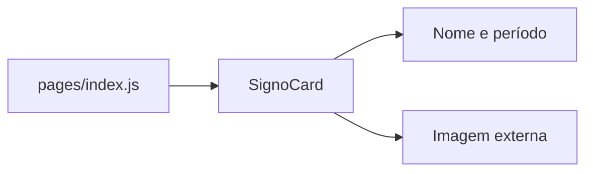

<div align="center">

# S I G N O S　//　Z O D I A C　U I

### `NEXT.JS • REACT • COMPONENTS • UI`

**Projeto acadêmico de interface em React/Next.js para apresentar signos do zodíaco em cards, com imagens e intervalos de datas.**


`ADS` · `FATEC` · `PROJETO ACADÊMICO`

[Visão geral](#visao-geral) · [Estrutura](#estrutura) · [Arquitetura](#arquitetura) · [Execução](#execucao)

</div>

---

<a id="visao-geral"></a>

## `PROJECT // VISÃO GERAL`

Projeto acadêmico de interface em React/Next.js para apresentar signos do zodíaco em cards, com imagens e intervalos de datas.

## `SYSTEM // STATUS`

| Recurso | Situação |
| :--- | :---: |
| Código fonte | `● DISPONÍVEL` |
| Documentação | `● DOCUMENTADA` |
| Publicação em produção | `◉ NÃO VERIFICADA` |

<a id="estrutura"></a>

## `STRUCTURE // ARQUIVOS E MÓDULOS`

| Arquivo / pasta | Responsabilidade |
| :--- | :--- |
| [`pages/index.js`](pages/index.js) | Página inicial com lista de componentes de signo |
| [`components/`](components/) | Componentes reutilizáveis da interface |
| [`package.json`](package.json) | Dependências Next.js, React e comandos de execução |

<a id="arquitetura"></a>

## `ARCHITECTURE // FLUXO`



<a id="execucao"></a>

## `BOOT SEQUENCE // COMO EXECUTAR`

```bash
git clone https://github.com/gilbertocorrea-cmd/Signos.git
cd Signos
```

**Executar localmente:** `npm install` e depois `npm run dev`. As imagens dos signos são referenciadas por URLs externas, então dependem da disponibilidade da fonte. A página inicial encontrada lista onze signos; não atribuí ao projeto uma listagem completa de doze sem confirmação.


---

<div align="center">

## `SIGNOS // BUILD • LEARN • EVOLVE`

**Gilberto Corrêa**

ADS — FATEC

[GitHub](https://github.com/gilbertocorrea-cmd)

</div>
